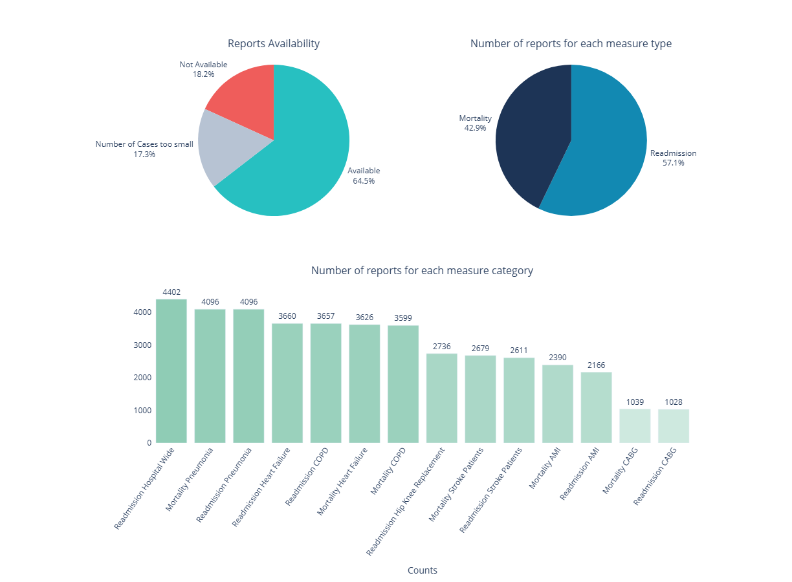

  

<h1 align="center">US Hospital Readmission and Mortality Rate Analysis</h1>
<table align="center">
  <tr>
    <td width="1440">
      <h2 align="center">Project Overview</h2>
      <body>
        Quantitative exploration of <strong>US hospital performance</strong> using <strong>CMS (Centers of Medicare & Medicaid Services)</strong> dataset. It focuses on two major metrics is:
         <li>Readmission Rates (patients returning within 30 days after discharge)</li>
        <li>Mortality Rates (patients dying within 30 days of hospitalization)</li>
        Nearly <strong>1.6M+</strong> patients were studied over the period of three years (2012/07-2015/06) to understand the quality of healthcare being provided. Each record represents a specific hospital and different quality metric combination, e.g.:"How XYZ Hospital performed in 30-Day Mortality Rate for Heart Failure, measured over a specific time frame." and the score is also compared to a national benchmark to provide insight on whether the hospital has performed better or worse compared to the overall national average. 
         Reporting to CMS, an in-depth analysis was conducted to evaluate US hospital's performance on readmission and mortality rates over the past several years (2012–2015). This comprehensive review provides valuable insights that help find patterns about readmits/mortality along different measures or answer questions about preformance fluctuations between different hospital which will be utilized by research facilities, hospitals, stakeholders and internal cross-functional teams will utilize in order to make informed decisions when designing patient care strategies and policies. The key insights and recommendations focus on the following areas:
      </body>
      <h3>Northstar Metrics</h3>
      <h4>
        <ul><li>Report Availability & Measure Coverage - Evaluated the completeness of reporting across mortality and readmission measures to understand which conditions have strong data availability and where gaps exist.</li>
          <li>Measure-level performance - Analyzed performance across 14 CMS-defined measures to identify which conditions exhibit higher mortality/readmission rates and which show lower risk and variability.</li>
          <li>Hospital-level outcome patterns - Aggregated results at the hospital level to detect consistent high performers, variation patterns, and systemic differences across facilities.</li>
          <li>Statistical Comparison of Cardiac vs Respiratory Outcomes - Performed Levene’s Test, t-tests, and effect size analysis (Cohen’s d) to quantify whether hospitals exhibit statistically meaningful differences between cardiac and respiratory care.</li>
          <li>Operational Implications & Recommendations - Interpreted findings to highlight specific condition areas and outcome categories where hospitals may allocate quality-improvement resources.</li>
        </ul>
      </h4>
      </td>
  </tr>
</table>

 

<table align="center">
  <tr>
    

      <h1 align="center">Executive Summary</h1>
      <strong>Report availability:</strong> From 64,764 raw records, there are 41,785 available reports, 11,779 not available, and 11,200 marked “cases too small”. Report counts differ by measure (e.g., Readmission Hospital Wide: 4,402 records; Readmission CABG: 1,028 records). 
      <strong>Hospital-level patterns:</strong> Top hospitals (e.g., Mayo Clinic Hospital, Northwestern Memorial, NYU Hospitals Center) show consistent specialization where measures they have low readmission generally coincide with low mortality for the same measure, suggesting focused clinical excellence. 
      <strong>Condition risk quadrant:</strong> Several measures land in High Score + High Variability (worse + inconsistent) such as Readmission Heart Failure and Mortality Pneumonia — these are priority targets. 
      <strong>Statistical testing (Cardiac vs Respiratory):</strong>
      <ul><li><strong>Readmission:</strong> Welch’s t-test t ≈ 40.55, p ≈ 0 → strong evidence cardiac readmission scores are higher than respiratory (i.e., worse). Levene indicates unequal variances. 
      <ul><li>Cohen’s d ≈ <strong>0.97</strong> (95% CI (Confidence Interval) ≈ [0.919, 1.015]) — <strong>large effect.</strong></ul>
      <li><strong>Mortality:</strong> Student t-test t ≈ -18.62, p ≈ 1.07e-75 → respiratory mortality mean is higher than cardiac; variances equal (Levene p ≈ 0.92). 
      <ul><li>Cohen’s d ≈ <strong>-0.43</strong> (95% CI ≈ [-0.48, -0.387]) — small–medium effect (favors cardiac being lower).<strong>small–medium effect (favors cardiac being lower).</strong></ul></ul>
      <strong>Conclusion:</strong> Differences are statistically significant and practically meaningful (especially readmission). Combined with quadrant results, the evidence supports prioritized operational focus on measures with high mean + high variance.
  </tr>
</table>

 

<h1 align="center">Data Structure</h1>

  

<h1 align="center">Insights Deep-Dive</h1>
<table align="center">
  <tr>
    <h1 align="center">Reports availability</h1>
    

      
    

  </tr>
</table>
<table>
  <tr>
    <td>
      <strong>Report Availability Analysis</strong>
        <li>An initial review of 64,764 hospital-measure records shows that 64.5% of performance reports are available, while the remaining 35% are missing due to “Not Available” status or insufficient case volume. Readmission measures are more consistently reported (57% of all available reports) than mortality measures (43%), indicating broader nationwide participation in readmission tracking.</li>
            <li>Report availability varies substantially across the 13 clinical measures. The most commonly reported metric—Hospital-Wide Readmission—includes data from 4,402 hospitals, while specialized procedures such as CABG mortality are reported by only 1,039 hospitals, reflecting limited national coverage. This 4x difference underscores the need to avoid naive cross-measure comparisons without accounting for differences in hospital participation.</li>
            <li>Overall, the dataset provides strong coverage for high-volume conditions such as pneumonia, COPD, and heart failure, while offering more selective insights for low-volume surgical and neurological measures.</li>
    </td>
  </tr>
</table>

 

<table align="center">
  <tr>
    <h1 align="center">Distribution of Scores by Measures</h1>
    

      
    

  </tr>
</table>
<table>
  <tr>
    <td>
      <strong>Distribution of Score</strong>
        <li>Distribution width suggests substantial performance variation as the total score range spans roughly <strong>2% to 32%</strong>, indicating large performance differences between hospitals and outcome measures are sensitive to hospital capacity, resources, and case mix scores follow a near-normal distribution centered ~15–17 the histogram shows a single, symmetrical peak between <strong>15 and 17</strong>, meaning most hospitals report scores in this range <strong>(median performance nationwide)</strong> and extreme high (>25) or low (&lt;8) scores are relatively rare.</li>
        <strong>Readmission vs Mortality</strong>
            <li>Violin plots clearly show structural differences between the two measure types, Readmission scores are consistently higher than mortality scores
            <strong>Median Readmission ≈ 17–18%, 
            Median Mortality ≈ 12–13%</strong>.
            Readmissions are much more common than deaths, so this difference reflects the reality of hospital operations, not poor performance.
            Readmission and Mortality has more high-end outliers (over 25%), indicating a small subset of hospitals struggle heavily with readmissions and mortality this could be due to poor follow-up processes, rural isolation, or high-risk populations</li>
    </td>
  </tr>
</table>

  <table>
    <tr>
      <h4>
        <strong>Top and Bottom 5 Measures by Average Score</strong>
      </h4>
      <td>
        
      </td>
    </tr>
  </table>

<table>
  <tr>
    <td>
        <li>Most of the Measures With Highest Scores (Worst Performance) are readmission measures such as <strong>Readmission Heart Failure, Readmission COPD, Readmission Pneumonia, Readmission AMI</strong>, with one exception in mortality that is Mortality Pneumonia which is obvious from the national benchmark comparison that Mortality Pneumonia is the highest(6.47%) measure which performs worse than the national rate.</li>
        <li>The measures with high scores have the highest national burden, with the worst-performing hospitals reaching ** >25–30% readmission/mortality** in extreme cases. The wide distributions indicate that hospitals struggle inconsistently, suggesting differences in patient complexity, poor care coordination, weak infection/respiratory management protocols.</li>
        <li>Some of the Measures With Lowest Scores (Best Performance) are mortality measures such as <strong>Mortality CABG, Mortality COPD, Mortality Heart Failure, Readmission Hip/Knee Replacement, Readmission Stroke</strong>. Procedures like CABG and orthopedic replacements show very low variation <strong>(1-8%)</strong>, reflecting high protocol maturity. These measures show tight, low score clusters, indicating highly standardized care pathways, predictable outcomes, strong clinical guidelines</li>
    </td>
  </tr>
</table>

 

<table align="center">
  <tr>
     <h1 align="center">Measure Performance Compared to National Benchmark Rate</h1>
      

        <h3>Majority of Hopsitals Performs "No Different than the National Rate"</h3>
        
      

    <tr>
  </tr>
</table>
<table>
  <tr>
    <td>
        <li>This chart breaks down each individual CMS measure and evaluates how many hospital–measure records fall into:
         <ul><ul><li><strong>Better than National Rate</strong> 
         <li><strong>No Different than National Rate</strong> 
         <li><strong>Worse than National Rate</strong></ul></ul></li>
         <ul>This gives us a highly granular view of how hospitals perform across specific conditions, instead of only high-level measure types.</ul>
        <li>Across all 14 measures a striking pattern emerges, The majority <strong>(87%–98%)</strong> of hospitals fall into <strong>“No Different than National Rate"</strong>. Every single measure is dominated by orange bars, meaning national benchmarks are relatively stable and most hospitals perform similarly with very few hospitals meaningfully outperform or underperform. This implies these measures are tightly regulated or have standardized care pathways.</li>
        <li>Alongside for almost every measure, the % of hospitals classified as Worse than the National Rate is larger than the % classified as Better than the National Rate. Example: <strong>Mortality Pneumonia shows ~6.5% worse vs ~6.0% better (a small difference)</strong>, but many measures show a clearer gap, though the tails are relatively small but when we compare the tails, the worse tail is generally larger than the better tail meaning there are more hospitals statistically and consistently worse than the national benchmark than hospitals statistically better.</li>
        <li>Few exceptional cardiac mortality measures specifically <strong>Mortality Heart Failure(4.55%) and Mortality AMI(2.3%)</strong> are the only categories where hospitals show a meaningfully higher percentage of “Better than the National Rate” compared to “Worse than the National Rate.” This indicates that unlike most other conditions where hospitals more often fall into the “worse” tail, cardiac care demonstrates a clear positive deviation from the national benchmark likely reflecting well-established clinical pathways, standardized treatment protocols, and greater maturity in quality improvement initiatives for cardiac care.</li>
    </td>
  </tr>
</table>

 

<table align="center">
  <tr>
     <h1 align="center">Top 3 US Hospitals Comparison</h1>
      

        <h3>Quality Performance is Codition-Specific</h3>
        
      

    <tr>
  </tr>
</table>
<table aign="center">
  <tr>
      <td width="333" valign="top">
      <h3>Mayo Clinic Hospital</h3>
      <ul>
        <li>Mayo Clinic Hospital <strong>(Low readmission, high mortality)</strong>: Best readmission performance overall with <strong>(Avg: 13.66%)</strong> and performs extremely well at <strong>Readmission Pneumonia (3.6%) and AMI (11%)</strong> and has the most consistent low readmission scores across all other measures, But worst mortality performance overall with <strong>(Avg: 9.80%)</strong> means Mayo discharges effectively (low readmission) but mortality is high in several severe conditions, <strong>Mayo’s areas of operational strength (cardiac surgery, AMI, pneumonia)</strong> show both low readmissions AND low mortality, meaning:</li>
        <li>Their end-to-end clinical practice including discharge, follow-up is efficient and acute care for those specific conditions are well integrated.</li>
      </ul>
      </td>
  <td width="333" valign="top">
      <h3>Northwestern Memorial Hospital</h3>
      <ul>
        <li>Northwestern Memorial Hospital <strong>(High Readmission, Low Mortality)</strong>: Weakest readmission performance across all three hospitals. with <strong>(Avg 15.66%)</strong> showing weakness at Readmission Hip/Knee Replacement(19.6%), Stroke(16.3%), CABG(16.4%) and performs well at <strong>Readmission COPD(4.9%) and Heart Failure(16.3%)</strong> which reflects back to one of the best mortality performance in <strong>Mortality COPD(2.8%) and Heart Failure(6.6%)</strong> and moderately consistent in other measures except Stroke Patients(12.2%)</li>
        <li>Northwestern’s inpatient care is strong (low deaths), but transitions back to the community could be causing return admissions. Focus on improved discharge planning, outpatient follow-up within 7 days, and remote monitoring for chronic conditions.</li>
      </ul>
      </td>
      <td width="333" valign="top">
      <h3>NYU Hospitals Center</h3>
      <ul>
        <li>NYU Hospitals Center <strong>(Moderate readmission, Moderate mortality)</strong>: Moderate readmission performance with <strong>(Avg 14.16%)</strong> and a consistently middle performer
        with extreme strengths in few specialization measures such as <strong>Readmission Hip/Knee Replacement(3.8%), Stroke and CABG(12%)</strong> as well as in <strong>Mortality CABG (2.3%) and Stroke(9.5%)</strong> but shows extreme <strong>weakness in Readmission Heart Failure (22.4%)</strong> among all hospitals and measured compared.</li>
        <li>NYU Hospitals Center is stable and consistent, with targeted improvement needed in Heart Failure and respiratory conditions such as (Pneumonia and COPD readmission).</li>
      </ul>
      </td>
</tr>
</table>

 

<table align="center">
  <tr>
     <h1 align="center">Condition Risk Quadrant (Score vs Variablility)</h1>
      

        
      

    <tr>
  </tr>
</table>
<table aign="center">
  <tr>
      <td width="333" valign="top">
      <h3>Q1</h3>
      <ul>
        <li>Q1 — <strong>High Score + High Variability(“National Crisis Zone”)</strong>: measures namely Mortality Pneumonia, Mortality Stroke Patients, Readmission Heart Failure, Readmission Pneumonia, Readmission COP  have high average scores indicates <strong>poor outcomes overall</strong>. They also show large variability meaning hospitals across the country are not consistently managing them well.</li>
        <li><strong>Pneumonia (Re-ad + Mortality)and COPD (Mortality)</strong> stand out as the most unstable and severe conditions in the entire dataset signaling persistent nationwide difficulty managing chronic respiratory patients</li>
        <li><strong>Readmission Heart Failure</strong> is particularly concerning as one of the highest scores and one of the most variable, indicating systemic struggle.</li>
        <li>These conditions represent the highest national risk. Hospitals lack consistent protocols, and patient outcomes vary widely. These are priority targets for CMS quality improvement programs.</li>
      </ul>
      </td>
  <td width="333" valign="top">
      <h3>Q2</h3>
      <ul>
        <li>Q2 — <strong>High Score + Low Variability (“Consistently Poor Zone”)</strong>: measures namely <strong>Readmission AMI, Readmission Hospital Wide</strong> is where the hospitals perform consistently poorly and variability is low, meaning the problem is widespread and predictable.</li>
        <li>Readmission AMI in particular shows a high mean score, signaling persistent nationwide <strong>difficulty managing cardiac patients</strong> same as the case with Readmission Heart Failure in first quadrant.</li>
        <li>These conditions are not outliers they represent systemic weakness that most hospitals struggle with equally. This consistency makes them ideal for national standardized protocols.</li>
      </ul>
      </td>
      <td width="333" valign="top">
      <h3>Q3</h3>
      <ul>
        <li>Q3 — <strong>Low Score + High Variability(“Opportunity Zone”)</strong>: even though the cardiac measures confronted low performance on readmissions they do better in mortality side, measures namely <strong>Mortality Heart Failure, Mortality AMI</strong> on average, hospitals perform well (low score). But variability is high meaning some hospitals are excellent others are significantly behind these conditions show the most uneven quality gap between top and bottom hospitals.</li>
        <li>These are the <strong>“best opportunities for targeted improvement.”</strong>
        Since many hospitals already excel, struggling hospitals could realistically achieve rapid improvement by adopting best practices.</li>
      </ul>
      </td>
      <td width="333" valign="top">
      <h3>Q4</h3>
      <ul>
        <li>Q4 — <strong>Low Score + Low Variability (“Strong Performance Zone”)</strong>: measures namely <strong>Readmission Hip Knee Replacement, Mortality CABG, COPD, Readmission Stroke Patients</strong> (borderline low variability) have both low severity and low variability. Hospitals across the country demonstrate stable, consistently <strong>strong performance</strong>, in particular Mortality CABG is the best performing measure nationwide, Readmission Hip Knee Replacement has both extremely low scores and the lowest variability of all 14 measures.</li>
        <li>These reflect highly standardized and mature clinical pathways.
        There is little variation, suggesting widespread adoption of effective care protocols.</li>
      </ul>
      </td>
</tr>
</table>

 

<table align="center">
  <tr>
     <h1 align="center">Distribution of Score by Measure Category</h1>
      

      <h3>Measures Segmented into Condition-Specific Categories</h3>
        
      

    <tr>
  </tr>
</table>
<table aign="center">
  <tr>
      <td width="333" valign="top">
      <h3>Orthopedic</h3>
      <ul>
        <li>Orthopedic procedures have the <strong>lowest scores and the tightest distribution (Mean: 4.61, Std: 0.55, IQR ≈ 4.3–4.9)</strong> and the most stable and least variable category amongst others, this means that Hip/knee replacement readmissions are highly standardized procedures with predictable risks and hospitals across the U.S. perform them with extremely consistent outcomes.</li>
      </ul>
      </td>
  <td width="333" valign="top">
      <h3>Respiratory</h3>
      <ul>
        <li>Respiratory conditions show a bimodal-like pattern and <strong>moderate-high variance (Mean: 15.50, Std: 4.57)</strong>,This category includes COPD and Pneumonia mortality/readmission. The violin plot shows two density peaks, reflecting two common hospital performance clusters <strong>Lower-risk pneumonia/COPD populations (scores ~13–16)</strong> and <strong>Higher-risk elderly or multi-morbidity populations (scores ~18–20)</strong>, Wide variability suggests respiratory outcomes depend heavily on quality of inpatient care, early antibiotic administration, chronic disease management processes.</li>
      </ul>
      </td>
      <td width="333" valign="top">
      <h3>Neurological</h3>
      <ul>
        <li>Neurological measures show <strong>moderate variability with upward skew (Mean = 13.76, skew = +0.67)</strong> means <strong>stroke-related measures tend to be lower than cardiac</strong> (less severe score values) but more skewed, meaning some hospitals perform significantly worse than the median. Stroke care is highly sensitive to door-to-needle time, access to neurologists, tele-stroke readiness, emergency response infrastructure thus neurological scores show early-warning-like characteristics with a cluster of good performers, but a longer tail of hospitals struggling with acute stroke care systems.</li>
      </ul>
      </td>
      <td width="333" valign="top">
      <h3>Cardiac</h3>
      <ul>
        <li>Cardiac measures show the <strong>highest variability and the highest extremes (Mean: 15.30, SD: 5.23, Max: 31.3)</strong>, Cardiac conditions <strong>(AMI, CABG, HF) are clinically complex</strong> with wide disparities in patient comorbidities, hospital capability, emergency response time, intensive care availability. <strong>High spread (IQR ≈ 12.5–19.7)</strong> means many hospitals operate at or near national norms (≈15) but some hospitals struggle significantly this indicate structural disparities in specialty care capability across U.S. hospitals.</li>
      </ul>
      </td>
</tr>
</table>

 

<table align="center">
  <tr>
     <h1 align="center">Statistical Comparison of Cardiac vs Respiratory Outcomes</h1>
      

      <h3>Statistically and Clinically Significant Difference between Cardiac vs Respiratory</h3>
        
      

    <tr>
  </tr>
</table>
<table aign="center">
  <tr>
      <td width="550" valign="top">
      <h3>Readmission (Cardiac vs Respiratory)</h3>
      <ul>
        <li>Cohen’s d = 0.97 (Large effect) 
        <li>95% CI = [0.919, 1.015]</li></ul>
        A Cohen’s d of <strong>0.97</strong> means the difference in hospital readmission performance between Cardiac and Respiratory conditions is large in magnitude, narrow CI indicates the difference is consistent across hospitals.
        <h3>Insight:</h3>
        <strong>Cardiac (Heart Failure, AMI, CABG) readmission rates are substantially higher than respiratory readmission rates</strong>. This is a large, meaningful clinical difference that reflects the fact that:
        <ul><li>Cardiac patients often have higher severity 
        <li>They return more frequently due to complex comorbidities 
        <li>The variation is not just random, it’s systematic across the entire U.S.</li>
      </ul>
      </td>
  <td width="550" valign="top">
      <h3>Mortality (Cardiac vs Respiratory)</h3>
      <ul>
        <li>Cohen’s d = -0.43 (Moderate effect) 
        <li>95% CI = [-0.480, -0.387]</li></ul>
        Effect size of <strong>–0.43</strong> means Cardiac mortality rates are moderately lower than respiratory mortality rates (negative sign simply means “group 2 > group 1”),tight CI indicates results are reliable and robust.
        <h3>Insight:</h3>
        <strong>Respiratory conditions (COPD, Pneumonia) have moderately higher mortality than cardiac conditions</strong> at U.S. hospitals. 
        This is clinically reasonable because: 
        <ul><li>Pneumonia & COPD mortality can spike due to acute infection, age, and frailty 
        <li>Cardiac mortality has improved dramatically in the last decade (better interventions, stents, acute MI protocols)</li>
        </ul>
      </ul>
      </td>
  </tr>
</table>
<td>
    <h3>Combined with t-test results</h3>
      <strong>Both Welch’s t-test (for readmission) and standard t-test (for mortality) showed extremely small p-values → strong evidence that the means differ.</strong> 
      Cohen’s d adds practical significance:
          <ul><li>Readmission difference → large and important in real-world terms.</li>
          <li>Mortality difference → moderate, so it matters but is less dramatic.</li></ul>
     <h3>Readmission Difference:</h3>
     A d of 0.97 means the difference between group means is almost one full standard deviation apart. 
     In practical terms:
          <ul><li>If you randomly picked a patient from the cardiac group and one from the respiratory group, there’s a big probability that the cardiac patient will have a higher readmission score.</li>
          <li>The overlap between the two distributions is small.</li></ul>
      In healthcare policy terms:
          <ul><li>This gap is large enough that hospital administrators would probably treat it as a high-priority difference — it’s not just statistically significant, it’s practically actionable.</li>
          <li>Example: If cardiac patients are readmitted at a much higher rate, this could indicate problems with discharge planning, patient education, or follow-up care for that condition.</li></ul>
      <h3>Mortality Difference:</h3>
      A d of 0.43 is moderate means the group means are less than half a standard deviation apart. 
      There’s still a noticeable difference, but there’s more overlap between the groups. 
      In practical terms:
          <ul><li>This might be clinically relevant, but not always strong enough to trigger an immediate large-scale intervention without more context and it’s less urgent compared to a d near 1.</li>
          <li>Example: Mortality differences exist, but other factors might explain them (severity, co-morbidities, etc.), so changes in care might be more nuanced.</li></ul>
</td>

 

<table align="center">
    <h1>Operational Implications and Recommendations</h1>
    <h4>Summary of Findings</h4>
        <h3>Readmission Rates:</h3>
        <li>Cardiac patients have significantly higher readmission rates than respiratory patients (Cohen’s d = 0.967, large effect).</li>
          <ul><li>This suggests that post-treatment care or discharge planning for cardiac cases may require closer attention.</li></ul>
        <h3>Mortality Rates:</h3>
        <li>Cardiac patients have moderately lower mortality rates compared to respiratory patients (Cohen’s d = -0.434, moderate effect).</li>
          <ul><li>Indicates that while cardiac treatment outcomes (survival) are relatively good, preventing readmissions remains a challenge.</li></ul>
        <h3>Implications for Hospital Management</h3>
        <li>High readmission rates for cardiac patients can increase costs (penalties from insurers/government programs) and signal gaps in post-discharge care.</li>
        <li>Lower mortality but higher readmission suggests that patients survive initial treatment but may not receive adequate follow-up or self-care guidance.</li>
        <h2>Recommendations:</h2>
        <h3>For Cardiac Patients:</h3>
        <li>Implement structured discharge protocols with clear follow-up schedules.</li>
        <li>Introduce telehealth monitoring within the first 30 days post-discharge.</li>
        <li>Provide patient education programs on medication adherence, diet, and lifestyle.</li>
        <h3>For Respiratory Patients:</h3>
        <li>Investigate causes behind higher mortality — e.g., late diagnosis, severity on admission, or comorbidities.</li>
        <li>Develop early detection and intervention programs for respiratory issues.</li>
        <h2>Limitations:</h2>
        <li>Data scope may be limited to a specific region/hospital system — results may not generalize to all healthcare settings.</li>
        <li>Readmission/mortality rates may be influenced by patient comorbidities, hospital facilities, patient care not accounted for in this dataset.</li>
        <li>Effect size interpretations are statistical however, clinical significance should be verified with domain experts.</li>
</table>

